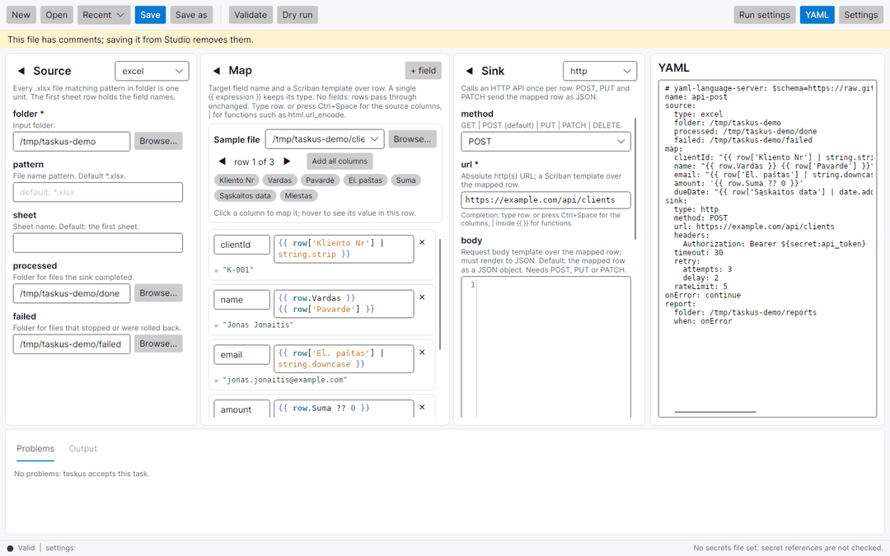

# Taskus Studio

Taskus Studio is a cross-platform desktop editor for task files of [Taskus](https://github.com/vdasus/taskus),
a command-line tool that reads rows from a source, maps them with Scriban templates and writes them to a sink.
Studio creates new task files and opens existing ones, validates them as you type with the same code the
`taskus` CLI uses, and shows the mapping result on real data. It runs on Windows, Linux and macOS
(Avalonia 12, .NET 10).



## Status

Version 0.8.1. Works with Taskus 0.8.x.

## Features

- Three-column **Source | Map | Sink** editor; the type is chosen in each column header. General settings
  are in a separate Run settings panel, and a live YAML preview slides out on the right.
- Live validation through `Taskus.Core`: errors show at the field and as a list in the bottom panel.
- Mapping preview on rows of an `.xlsx` source.
- Template editor with Scriban highlighting for the map and for template settings (http url and body, excel
  file name). Completion: `row.` or Ctrl+Space lists the fields (source columns in the map, mapped fields in
  the sink), `|` lists common functions such as `html.url_encode`, `string.strip`, `date.to_string`.
- The smtp section can be one `${secret:name}` mapping chosen from the secret picker.
- Secret picker that lists only the key names from the secrets file and inserts `${secret:name}`; values
  are never shown.
- Validate and Dry run through the `taskus` CLI, with its console output in the bottom panel.
- New tasks from templates based on the Taskus examples.
- Light and dark theme, or follow the system setting.

## Compatibility

Taskus Studio and Taskus share `major.minor`; patch numbers are independent. Studio `X.Y.n` works with any
Taskus `X.Y.*`. Before Validate or Dry run, Studio shows a warning when the `major.minor` reported by
`taskus --version` differs from its own.

## Install

1. Download the zip for your platform from [Releases](https://github.com/vdasus/taskus-studio/releases).
   Each release has six zips, named `taskus-studio-<version>-<platform>-<kind>.zip`: platform `win-x64`,
   `linux-x64` or `osx-arm64`, and kind `self-contained` or `framework-dependent`. Each zip has a
   `.sha256` file next to it.
2. Unpack it to any folder.
3. Run `taskus-studio` (`taskus-studio.exe` on Windows). On Linux and macOS, the file may need the
   execute permission after unpacking: `chmod +x taskus-studio`.

Which kind to choose:

- **self-contained:** runs without a .NET installation. Choose it when .NET 10 is not installed.
- **framework-dependent:** much smaller. Needs the .NET 10 Desktop Runtime on Windows, or the .NET 10
  Runtime on Linux and macOS.

Each zip holds a single executable, `README.md` and `LICENSE`. `taskus` is not included; install it
separately and set its path in Studio.

- **macOS:** the builds are not signed or notarized. Remove the quarantine attribute before the first run:
  `xattr -dr com.apple.quarantine <folder>`.
- **Linux:** Studio needs a desktop session (X11 or Wayland).

## Settings

Settings are stored in `taskus-studio.json` next to the executable. When that folder is not writable
(for example Program Files or macOS App Translocation), Studio uses the user folder instead:

| Platform | Folder |
|----------|--------|
| Windows | `%APPDATA%/TaskusStudio` |
| Linux | `~/.config/TaskusStudio` |
| macOS | `~/Library/Application Support/TaskusStudio` |

The status bar shows the path in use. Stored settings:

- path to the `taskus` executable;
- path to the secrets file;
- recent files;
- theme (system, light or dark).

## Build

Requires the .NET 10 SDK.

```sh
dotnet build
dotnet test
dotnet run --project src/TaskusStudio
```

Studio references an exact version of the `Taskus.Core` NuGet package. CI restores it from nuget.org, so
Taskus.Core 0.8.0 must be published there before CI can build this version. To build against a
`Taskus.Core` that is not yet on nuget.org, pack it from a Taskus checkout next to this repository; the
`local-packages` folder is listed as a package source in `nuget.config`:

```sh
dotnet pack ../Taskus/src/Taskus.Core -c Release -o local-packages
```

### Screenshots

The README GIF is rendered headlessly from the `excel-to-api-post` template and the sample
`clients.xlsx`. After a UI change, rebuild it from the repo root (needs [uv](https://docs.astral.sh/uv/)):

```sh
dotnet run --project tools/Screenshots
uv run --with pillow tools/Screenshots/make-gif.py
```

The first command writes PNG frames to `temp/screenshots/` (git-ignored), the second joins them into
`docs/images/demo.gif`.

## Release steps

1. Bump `<Version>` in `src/TaskusStudio/TaskusStudio.csproj`.
2. Set the `Taskus.Core` version in `Directory.Packages.props` to the matching Taskus release, and make
   sure that version is published on nuget.org.
3. Commit, then tag and push: `git tag vX.Y.Z && git push origin vX.Y.Z`.

The `Release` workflow runs the tests, builds self-contained and framework-dependent zips for
`win-x64`, `linux-x64` and `osx-arm64` (six zips) with a sha256 file each, and creates the GitHub
release. Versions `0.x` and versions with a `-` suffix are marked as pre-release.

## License

MIT, see [LICENSE](LICENSE).
